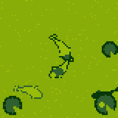
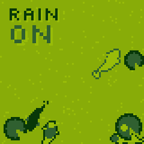
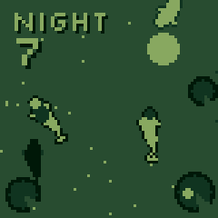
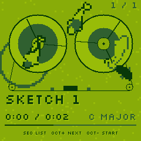
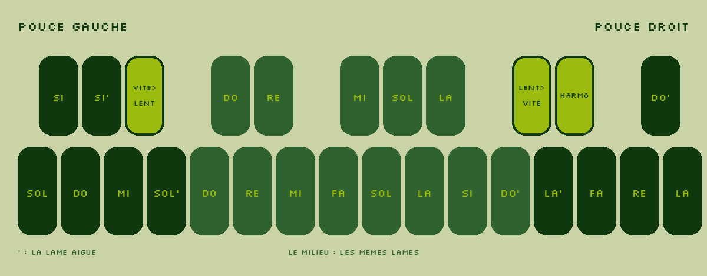
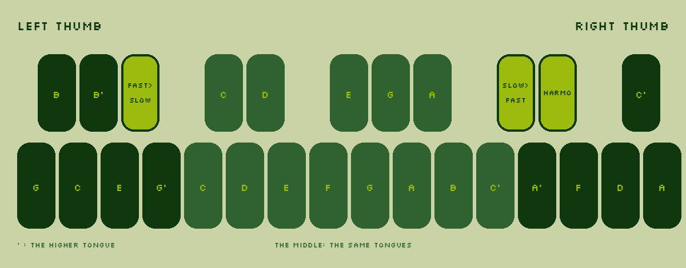

# Modular Koi

[](LICENSE)

   

**FR** · Un firmware libre qui transforme le **M-VAVE FM-1** en tambour à languettes, par
[Bungle Society](https://www.youtube.com/@bunglesociety). On le tient à deux mains, on joue avec les pouces, et chaque
note tombe comme une goutte dans un bassin où nagent des carpes koï.

**EN** · A free firmware that turns the **M-VAVE FM-1** into a steel tongue drum, by
[Bungle Society](https://www.youtube.com/@bunglesociety). You hold it in both hands, play with your thumbs, and every
note falls like a drop into a pond where koi swim.

- **Installer · Install:** [bunglesociety.github.io/modular-koi/install](https://bunglesociety.github.io/modular-koi/install/)
  (Chrome or Edge, a USB cable, nothing else). The page reads the FM-1 first: what runs on it and its version.
- **Page:** [bunglesociety.github.io/modular-koi](https://bunglesociety.github.io/modular-koi/)
- **Firmware:** `modular-koi-VERSION.fwsc` in the [Releases](https://github.com/bunglesociety/modular-koi/releases)
- Its siblings: [Modular One](https://bunglesociety.github.io/modular-one/) (the FM-1's film-music firmware),
  [Modular Compagnon](https://bunglesociety.github.io/modular-compagnon/) (SMK-37 Elite, [COMPAGNON.md](COMPAGNON.md)),
  [Modular Town](https://amorph.audio/patches/modular-town-v3/) (a patch for Amorph)

## Les touches · The keys





| | FR | EN |
|---|---|---|
| Touches · Keys | Les onze lames du tambour, en do majeur au départ (sol la si, do … do aigu), sous chaque pouce ; au milieu, les mêmes | The drum's eleven tongues, in C major at first (G A B, C … high C), under each thumb; the same in the middle |
| OP3 · MONO | Roulements sur la dernière lame : vite puis lent · lent puis vite (un appui : le geste ; maintenu : il continue) | Rolls on the last tongue: fast then slow · slow then fast (a tap: the gesture; held: it goes on) |
| POLY | L'harmonique (l'octave chante) | The harmonic (the octave sings) |
| PRESETS · ALGORITHM | La gamme (6) · la matière (acier, grand tambour grave, verre, bois) | The scale (6) · the material (steel, low drum, glass, wood) |
| K1 · K2 · K3 | Frappe · résonance · rebonds au bord du bassin. Son sec : ni écho ni réverbe | Strike · resonance · bounces at the pond's edge. Dry: no echo, no reverb |
| ARP | La pluie : le tambour joue seul et répond quand tu joues | The rain: the drum plays by itself and answers when you play |
| SELECT | Le jour, la nuit | Day, night |
| REC · OCT- + OCT+ | Le carnet de croquis et le magnéto, comme dans Modular One | The sketchbook and the tape player, as in Modular One |
| SEQ maintenu · held | La liste : K1 choisit, REC deux fois efface, lâcher SEQ joue | The list: K1 chooses, REC twice erases, letting go of SEQ plays |
| SEL · SAVE · GLO | Nourrir les carpes · garder ton tambour · réglages (tonalité de do à si, carpes, ronds sur l'eau, hiver, canal MIDI, accordage, haut-parleur, veille) | Feed the koi · keep your drum · settings (key from C to B, koi, ripples, winter, MIDI channel, tuning, speaker, sleep) |

Croquis et morceaux sont gardés au même endroit que dans Modular One : on passe de l'un à l'autre sans les perdre.
Sketches and songs live where Modular One keeps them: switching between the two keeps them.

Les FM-1 récents (vendus depuis fin 2026, le logo imprimé sur la façade) ont une autre puce de mémoire (UC25HQ80,
JEDEC 0xB36014) : Modular Koi la connaît, comme celle des premiers (Puya P25Q80, 0x856014).
Recent FM-1s (sold from late 2026, the logo printed on the front) have another flash chip (UC25HQ80, JEDEC 0xB36014):
Modular Koi knows it, as well as the first units' (Puya P25Q80, 0x856014).

## Construire · Build

Built on [Felucca](https://github.com/hugelton/Felucca) 1.6.1 by Leo Kuroshita ([Hügelton Instruments](https://hugelton.com)).
This tree is shared with Modular Compagnon. See [BUILDING.md](BUILDING.md) for the toolchain (the JieLi AC79 SDK is not
in this tree; `git clone --recursive` for `firmware/engines`), then:

```sh
BOARD=koi ./build.sh --release 0.1          # -> build/modular-koi-fm1-0.1.fwsc (identity FM-1_901, "KOI 0.1")
tests/run_tests.sh
python3 tools/make_m1_installer.py --koi build/modular-koi-fm1-0.1.fwsc Modular-Koi.html 0.1   # one-file installer
python3 tools/make_koi_site.py build/modular-koi-fm1-0.1.fwsc 0.1 docs/                        # GitHub Pages (docs/)
```

The Modular Koi code: `firmware/src/eng_koi.c` (the drum: tongues, sympathy, materials, scales), `firmware/src/koi_play.c`
(keys, rolls, rain, rebounds), `firmware/src/koi_ui.c` (controls, GLO), `firmware/src/koi_draw.c` (the pond, the koi,
the tape), `tests/koi_fm1.c` (host test, the GIFs), `tools/make_koi_keys.py`, `web/koi-fm1/` (the install page and
`block.html`, the bunglesociety.com page), `web/fm1probe.js` (what runs on the device, read before installing).

## Licence · License

GPL-3.0-only, like Felucca: [LICENSE](LICENSE), [LICENSING.md](LICENSING.md), [LICENSES/](LICENSES/), [CREDITS.md](CREDITS.md).
The pixel font is [Silkscreen](https://github.com/googlefonts/silkscreen) by Jason Kottke (SIL OFL 1.1).
Felucca's own README: [README-FELUCCA.md](README-FELUCCA.md).

Not affiliated with M-VAVE. FM-1 is their product name, used only to say which synth this runs on.

© 2026 Alexis Arakis · Bungle Society
